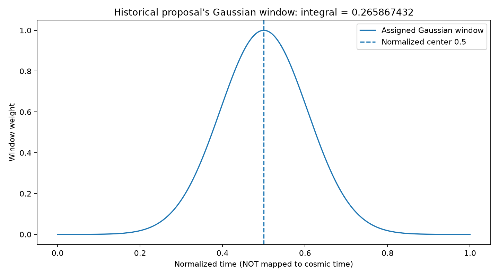
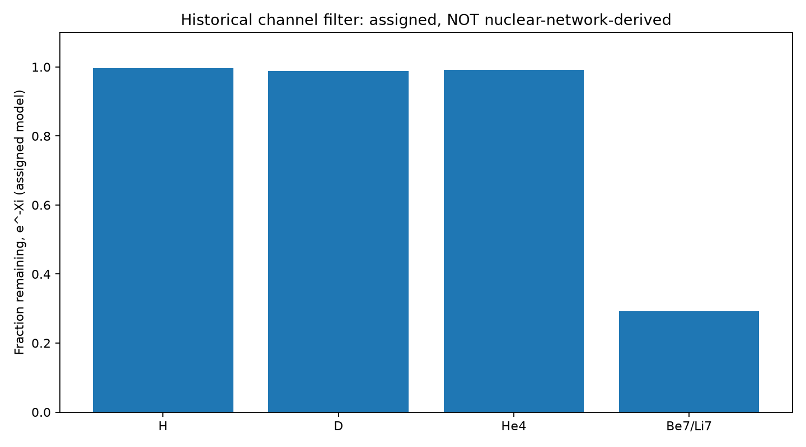
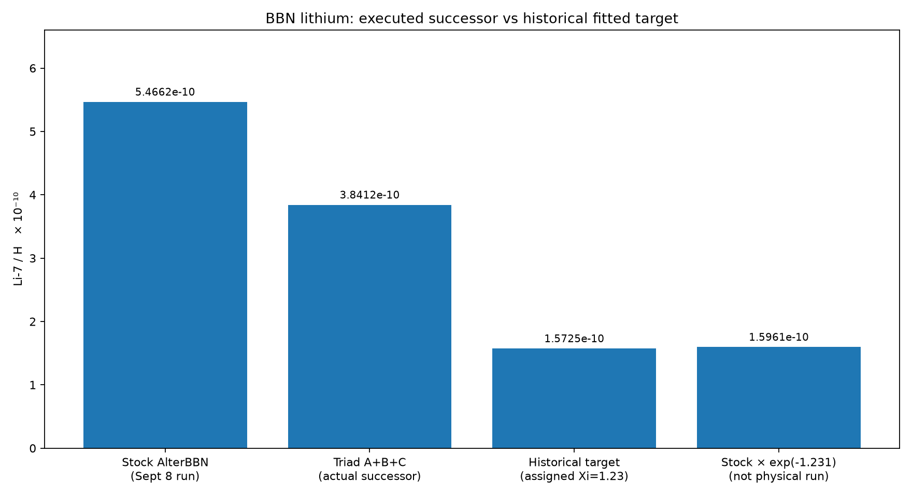
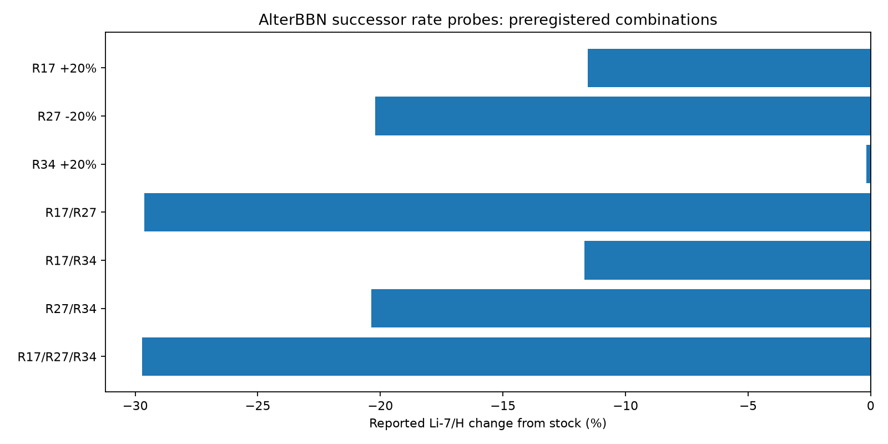

# BBN / lithium-7: source-preserving numerical reconstruction

**Research status:** historical hypothesis plus later executable successor checks; **not a solved cosmology result**. The numerical reconstruction and diagrams on this page were freshly generated from the cited archived values on 18 October 2026. They are not the original May code, an independent observation, or a new AlterBBN run.

## The human-readable question

Standard Big Bang nucleosynthesis (BBN) predicts how much of each light element should be left from the early universe. The historical Distel Theory (DT) proposal asked whether a *short-lived, selective* process could reduce the mass-7 channel (beryllium-7 that becomes lithium-7) **without spoiling** the otherwise successful deuterium and helium abundances.

A mathematical formula can be tuned to match the lithium target. That is different from finding an actual nuclear reaction, particle, or cosmological process that causes the change. The later recovered source explicitly acknowledges that difference.

## Historical source chain — distinct versions

1. [May 2026 draft v1.4](https://drive.google.com/file/d/1KgoT0DEBZym1cQGKhFwS1UO3MDVUE816/view): introduces accessibility/persistence terminology, mass-7 survival and a claimed surrogate network result. Some wording in that draft presents an operator as validated; the subsequently recovered audit rejects treating it as a completed real nuclear-network proof.
2. [July 14 corrected professor-facing audit](https://docs.google.com/document/d/1cAG2YTMJXMLuFWZCsNzAAwDkNHeJyygnKVHH3PCMsTQ/edit): supplies the historical numbers and documents the parameter mismatch, lack of mapped physical time, and lack of coupled full-network validation.
3. [September 8 actual AlterBBN v2.2 successor execution](https://github.com/forum1100/Distel-Theory-Research/blob/main/retests/BBN_ALTERBBN_EXECUTION_2026-09-08.md): separate stock model execution, sensitivity trials, preregistered reaction-rate triad, recorded limitation. **This is the strongest execution evidence, not evidence for the original DT operator.**
4. [Recovered historical source registry and failures](../recovered/dt-research-public/simulations/replay/registry.json) and [mass-7 retest record](../recovered/dt-research-public/retests/BBN_LITHIUM7.md).

## 1. The original survival equation

`Y7_DT = Y7_BBN * exp(-Xi7)`

**Every term:** `Y7` is the lithium-7 abundance relative to hydrogen; `Xi7` is a dimensionless assumed integrated removal-strength parameter; `exp` is the exponential function. This is the solution of the *assumed* first-order loss equation `dY7/dt = -lambda(t)*Y7`, where `Xi7 = integral lambda dt`. The differential-equation solution is mathematically valid **given** that loss law; the loss law itself is not a derived nuclear interaction.

Historical baseline `Y7_BBN = 5.38e-10`. Chosen `Xi7 = 1.23`. Then:

- `exp(-1.23) = 0.2922925776808594`
- `Y7_DT = 1.5725340679230238e-10`
- This is a factor `1/0.29229 ~ 3.42` attenuation. **The numerical value is target matching, not a mechanism measurement.**

## 2. How the original operator conflicts with the target

The May draft prints `Xi7 = q7 * E7 * chi7 ≈ 1.23`, but also lists `q7 = 1.05`, `E7 = 17.24`, `chi7 = 1.36`. Multiplication gives about `24.62`, **not 1.23**. The formula therefore omits a normalization/integration factor or uses inconsistent parameter definitions.

The July corrected audit specifies a *different* operator:

`lambda(t) = q_gamma * sqrt(E_gamma) * chi_gamma * exp(-((t-0.5)/0.15)^2)`.

Under its assumed normalized time interval `t in [0,1]`, the Gaussian window integrates to `0.2658674319838486`. Therefore:

- `q = 1.05` implies integrated `Xi ≈ 1.5763838574`, **not 1.23**.
- `Xi = 1.23` requires `q ≈ 0.8192801480` for that exact window.
- Alternatively, the listed q requires a different integral near `0.2074475324`.
- The normalized time was **not calibrated to actual seconds, temperature in keV, or a named nuclear reaction epoch**; it cannot automatically be substituted into an AlterBBN rate equation.

These are three distinct branches to preserve: the May written form, the July `sqrt(E)` window form, and the target-fit exponent.



## 3. Historical source-assigned filter values

| Channel | Assigned Xi | Exponential remaining fraction | Meaning |
|---|---:|---:|---|
| Hydrogen | 0.004 | 0.9960079893 | Chosen small loss, not a calculated network yield |
| Deuterium | 0.012 | 0.9880717129 | Chosen small loss |
| Helium-4 | 0.008 | 0.9920319148 | Chosen small loss |
| Be-7 / Li-7 | 1.231 | 0.2920004312 | Chosen much larger loss |

The values were assigned to create selectivity; they do **not** demonstrate that an actual physical process would leave the other nuclides undisturbed. Exact values and machine-computed fractions are in [CSV](../runs/bbn/channel_survival.csv) and [JSON](../runs/bbn/source_reconciliation_2026-10-18.json).



## 4. What was actually executed on September 8

The recovered execution notes report untouched stock **AlterBBN v2.2** compiled with GCC 16.2.0 and GNU Make 4.4.1, with archive SHA-256 `46B94253CDE6AFCE15DDB9367FA454BAC91B25C9A1D3412CC19E512EC3515C17`.

| Stock model quantity | Reported result |
|---|---:|
| Helium-4 mass fraction Yp | 0.2472892431214 |
| Deuterium / H | 2.434823987112e-5 |
| Helium-3 / H | 1.031143037369e-5 |
| Lithium-7 / H | 5.466171494978e-10 |
| Lithium-6 / H | 1.072668319169e-14 |
| Beryllium-7 / H | 5.179861834299e-10 |

These are outputs *reported in the dated executable successor run document*, not outputs of the new arithmetic reproduction.

The separately preregistered rate probes were:
- **A:** R17 × 1.20 (Be7 + neutron reaction), Li7/H change **-11.5453%**.
- **B:** R27 × 0.80 (He3 + He4 → Be7), change **-20.2220%**.
- **C:** R34 × 1.20 (Be7 + deuterium reaction), change **-0.1721%**.
- Combined **AB: -29.6204%**, **AC: -11.6801%**, **BC: -20.3595%**, **ABC: -29.7280%**.

The strongest three-rate result was **3.841190679596e-10** Li7/H, down **29.728%** from stock. The historical selected survival factor corresponds to about **70.8%** suppression and a stock-adjusted target of **1.596122076534e-10**. The three-rate successor **did not reach that target**.

The three isolated responses sum to `-31.9394 percentage points`. The executed ABC response is only `-29.7280`: **2.2114 points less suppressive** (sub-additive). This is *not* the claimed emergent relational amplification.





## 5. Reproduction and evidence

The code [`simulations/bbn_lithium_reconstruction.py`](../simulations/bbn_lithium_reconstruction.py) recomputes all exponentials, the Gaussian-window integral, the q correction, the percent reductions, and generates **four PNG + four SVG** visualizations. The [tests](../tests/test_bbn_lithium_reconstruction.py) check the recovered numerical identities and reject conflation of source forms.

Local, free execution:

```powershell
python -m unittest discover -s tests -v
python simulations/bbn_lithium_reconstruction.py
```

Requires Python stdlib for arithmetic and Matplotlib only for figures. To run *arithmetic without plots*, use `--no-plots`. JSON output: [run](../runs/bbn/source_reconciliation_2026-10-18.json). Raw historical AlterBBN experiment logs remain separately cited in the original research repository.

## 6. Decisive scientific work still missing

- A correctly dimensioned operator derived from an independently motivated mechanism rather than fitted to the lithium discrepancy.
- Mapping of the window to cosmic temperature/time, with specific allowed reactions and uncertainties.
- The actual proposed DT operator integrated into a trusted coupled BBN solver with full species/network conservation and sensitivity sweeps.
- Independent abundance datasets, error bars, priors and blinded comparisons (D/H and Yp must remain acceptable).
- Independent reproduction by a separate team/solver; failures, energy/entropy costs and alternative explanations.

**Conclusion:** the numbers and arithmetic are preserved and reproduced, and the stock AlterBBN successor result is documented. The original selective-suppression mechanism **has not passed** the decisive independent nuclear-network test. This limitation is part of the research, not something to hide.
